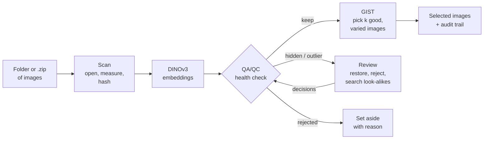

# QA/QC GIST

**Quality control and diverse subset selection for image datasets.**

QA/QC GIST is the method we use to check large collections of field images and
then choose which ones to label, train on or benchmark with. It does two jobs:

1. **QA/QC.** Every image is checked and placed in one of four buckets, with a
   plain-language reason: **keep**, **hidden** (near-duplicates and tiny
   images), **outlier** (unusual for this dataset, to review) or **rejected**
   (unreadable, blank, exact copies). Reviewers can overrule any decision,
   and their decisions survive every rerun.
2. **Selection with GIST.** From the images that pass, GIST picks exactly *k*
   that are both good (sharp, or what a reviewer prefers) and different from
   each other, so a labelling budget or a benchmark covers the variety in the
   collection instead of a hundred copies of the same scene.

Images are compared with [DINOv3](https://github.com/facebookresearch/dinov3)
embeddings. The selection step follows the max-min diversification objective
of the GIST paper (Fahrbach et al., NeurIPS 2025), adapted for this
workflow; see [How it compares to the paper](docs/METHOD.md#how-it-compares-to-the-gist-paper).

We built it for crop field images (plots, leaves, canopies, phone and action
cameras), but nothing in it is specific to crops.



## What it checks

| Check | How | Result |
|---|---|---|
| Cannot be opened | decode the file | rejected |
| Blank frame | contrast (pixel standard deviation) below 5 | rejected |
| Exact copy | identical SHA-256 of the file bytes; the first copy is kept | rejected |
| Tiny | fewer than 2,500 pixels | hidden |
| Near-duplicate (bursts, re-shoots) | DINOv3 similarity ≥ 0.97 to a **sharper** image; chains followed to the sharpest copy, which is kept | hidden |
| Outlier | any of three robust checks: isolated (no close look-alikes), off-topic (far from the dataset as a whole), unusual signal strength | outlier |
| Blurry, dark, bright, low contrast, odd shape | simple pixel statistics | tag only |

Every threshold is a setting. The full method, with formulas, is in
[docs/METHOD.md](docs/METHOD.md). How we run it as a QA/QC process, from a
new batch of field images to a selected set, is in
[docs/QAQC_WORKFLOW.md](docs/QAQC_WORKFLOW.md).

## Install

```bash
git clone https://github.com/CIAT-Artemis/Data_QA_QC.git
cd Data_QA_QC
pip install -e ".[all]"        # torch, timm, plots, UMAP, demo data, progress bars
```

The core package needs only numpy, Pillow and scikit-learn; `[embed]` adds
torch and timm (≥ 1.0.20) for DINOv3. A GPU makes embedding much faster but
is not required.

**DINOv3 weights** are downloaded once from Hugging Face (timm's copy, about
1.2 GB for ViT-L/16) the first time you run. They are released by Meta under
the [DINOv3 License](https://ai.meta.com/resources/models-and-libraries/dinov3-license),
separately from this code; read it before use. For offline machines, pass a
local `.safetensors` file with `--weights`.

## Quick start

Try it on a small built-in set with planted problems (burst shots, an exact
copy, a blurred copy, a blank frame, a tiny image, a corrupt file):

```bash
qaqc-gist demo --out demo_out
```

Run it on your own images and pick 200:

```bash
qaqc-gist run path/to/images --out run1 --k 200
```

Each image's checks and embedding are saved in the run folder, so running
again after adding images to the folder only processes the new ones, and the
reviewer decisions in `run1/decisions.csv` are applied again automatically.

Then, in seconds, without recomputing embeddings:

```bash
# pick again with other settings (more diversity, fewer images)
qaqc-gist select run1 --k 100 --alpha 0.5

# find every image that looks like a problem frame
qaqc-gist search run1 --example plot_07/GOPR0042.JPG --threshold 0.9

# apply a reviewer's decisions (CSV: rel_path,decision) and pick again
qaqc-gist select run1 --k 200 --decisions review.csv

# steer the selection with examples
qaqc-gist select run1 --k 200 --liked good_leaf.jpg --disliked thumb_over_lens.jpg
```

### From Python

```python
from qaqc_gist import analyse, write_outputs

ds = analyse("path/to/images", work_dir="run1")      # checks + embeddings (cached)

ds.assess(decisions={"plot_03/IMG_0101.jpg": "reject",   # reviewer decisions
                     "plot_05/IMG_0222.jpg": "keep"})

hits = ds.search(["plot_07/GOPR0042.JPG"], threshold=0.9)   # look-alikes
ds.assess(decisions={h["id"]: "reject" for h in hits["results"]})

picked = ds.select(k=200, alpha=0.75, liked=["good_leaf.jpg"])
print(picked["selected"][:10], picked["reasons"])     # ids in pick order, and why others were not

write_outputs(ds, picked, "run1")
```

`select`, `search` and `assess` also work on your own embeddings: see
`qaqc_gist.select`, `qaqc_gist.search` and `qaqc_gist.assess`. Any embedder
works with `analyse(embedder=...)`: a callable that takes a list of image
paths and returns an `(n, d)` array.

### Google Colab

```python
!pip install -q "qaqc-gist[plots,umap,demo] @ git+https://github.com/CIAT-Artemis/Data_QA_QC.git" "timm>=1.0.20"
!qaqc-gist run /content/drive/MyDrive/my_images --out /content/run1 --k 200
```

Choose a GPU runtime (Runtime → Change runtime type → T4 GPU). Colab already
has torch; the command above does not reinstall it. Reading thousands of
images straight from Drive is slow: zip the folder, copy the zip to
`/content`, and pass the zip instead.

## Outputs

| File | Contents |
|---|---|
| `results.csv` | every image: measurements, QA/QC bucket and reason, reviewer flag, GIST decision and reason |
| `selected.csv` | the picked images, in the order GIST picked them |
| `decisions.csv` | reviewer decisions so far; edit it and pass it back with `--decisions` |
| `summary.json` | settings, counts and versions: what is needed to reproduce the run |
| `dataset.npz` | embeddings and records, used by `select` and `search` |
| `cache/` | each image's checks and embedding, so reruns only process new files |
| `selected_images/` (+ `.zip`) | copies of the picked images, sub-folders kept |
| `plots/` | 2-D map, picked and left-out thumbnails with reasons, outliers, near-duplicate pairs |

## Settings that matter most

| Setting | Default | Meaning |
|---|---|---|
| `k` | 100 | how many images GIST picks |
| `alpha` | 0.75 | 1.0 = quality only, 0.0 = diversity only |
| `duplicate_threshold` | 0.98 | similarity GIST treats as the same picture |
| `near_duplicate_similarity` | 0.97 | similarity at which the health check hides the less sharp copy |
| `outlier_mad_multiplier` | 2.0 | outlier cut = median + m × MAD; raise it for fewer outliers |

Similarity thresholds were tuned on DINOv3 ViT-L/16. Other models (including
smaller DINOv3 variants) spread similarities differently, so check the
near-duplicate pairs and outliers on a first run and adjust.

## Tests

```bash
pip install -e ".[dev]"
pytest
```

The tests use synthetic embeddings and a stand-in embedder, so they run in
seconds on any laptop, without a GPU or a model download.

## Citation

If you use this in your work, please cite the GIST paper:

```bibtex
@inproceedings{fahrbach2025gist,
  title     = {{GIST}: Greedy Independent Set Thresholding for Max-Min Diversification with Submodular Utility},
  author    = {Fahrbach, Matthew and Ramalingam, Srikumar and Zadimoghaddam, Morteza and
               Ahmadian, Sara and Citovsky, Gui and DeSalvo, Giulia},
  booktitle = {Advances in Neural Information Processing Systems (NeurIPS)},
  year      = {2025},
  note      = {arXiv:2405.18754}
}
```

and DINOv3 for the embeddings (Siméoni et al., 2025, arXiv:2508.10104).

## License

The code is released under the [MIT License](LICENSE). DINOv3 model weights
are not part of this repository and are covered by Meta's own license.
