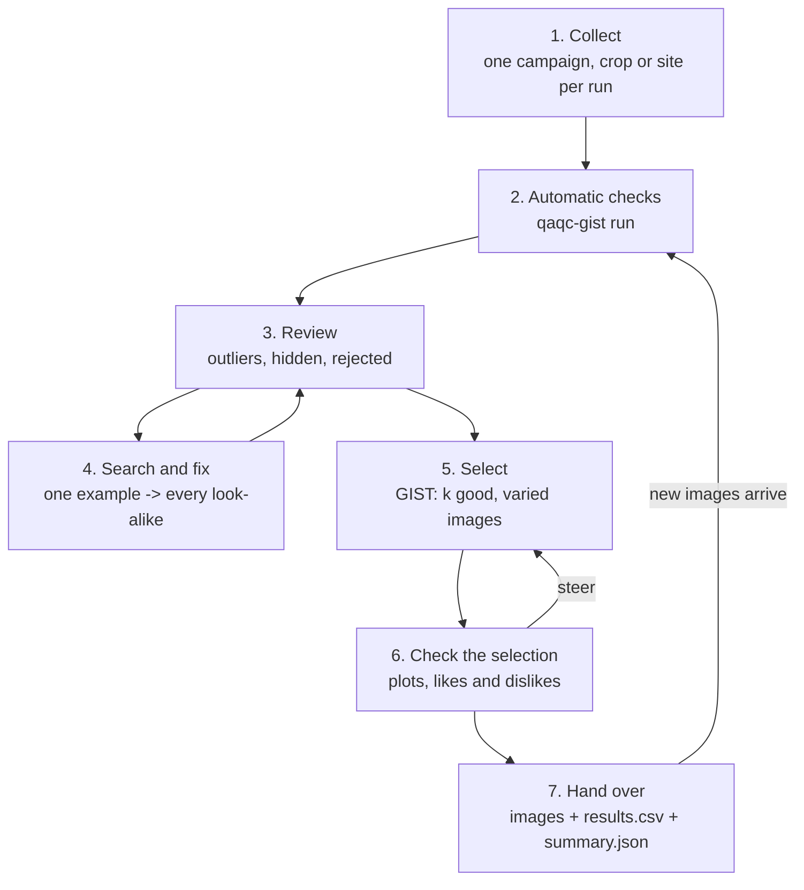

# How we use QA/QC GIST

This is the process we follow to turn a raw batch of field images into a
checked collection and a selected set: for annotation, for training, or for a
benchmark. The method itself is described in [METHOD.md](METHOD.md).

## Why QA/QC comes before selection

Field image collections are messy in predictable ways. Action cameras and
phones shoot bursts, so the same plot appears dozens of times. Some frames
are black, blurred, or show a hand, the sky or the inside of a bag. Folders
get copied twice. A few photos of another crop end up in the wrong folder.

If you pick images for labelling at random, or by hand, you spend budget on
copies and on frames nobody can label, and you still miss the rare cases.
QA/QC GIST removes the unusable images first, sets the redundant ones aside
with a pointer to the copy that was kept, puts the unusual ones in front of a
person, and only then chooses: a fixed number of images that are sharp and
as different from each other as possible.

Every decision, automatic or human, is written down with its reason, so the
selected set can be explained and the run repeated.

## The loop



### 1. Collect

Put one coherent collection in a folder: one crop, campaign or site. Sub-folders
(per plot, per day, per camera) are fine and are kept in every output. The
off-topic check measures distance from the collection's centre, so mixing very
different collections in one run makes the smaller ones look like outliers.

### 2. Automatic checks

```bash
qaqc-gist run field_images/2025_season_a --out runs/season_a --k 300
```

This opens every image, measures it, embeds it with DINOv3 and sorts it into
keep / hidden / outlier / rejected. Look at the printed counts, then open
`runs/season_a/results.csv` (sort by `qaqc_bucket`) and the sheets in
`runs/season_a/plots/`.

What to expect, roughly: rejected should be small (corrupt files, blank frames,
exact copies). Hidden is often large for burst-heavy cameras; that is the
point. Outliers depend on the collection; a few percent is typical.

### 3. Review

Review in this order, because it is where errors cost the most:

1. **Outliers, most-flagged first** (`plots/outliers_grid.png`, or
   `outlier_votes` in `results.csv`). Most are bad frames: reject them. Some
   are rare and valuable (an early growth stage, a disease, unusual light):
   keep those, because they are exactly what a model needs to see.
2. **Near-duplicate pairs** (`plots/near_identical_pairs.png`). Check that the
   hidden image really is a copy of the kept one. If true variety is being
   hidden (for example consecutive plants in a row), raise
   `near_duplicate_similarity` a little, e.g. to 0.98.
3. **Rejected**, quickly: these should be obvious.

Record decisions in `runs/season_a/decisions.csv`, one image per line:

```csv
rel_path,decision
plot_12/GOPR0451.JPG,reject
plot_07/GOPR0102.JPG,keep
```

Decisions can be `keep`, `hidden`, `outlier` or `rejected` (also `restore`,
`hide`, `reject`). They always win over the automatic rules and are re-applied
on every later run in that folder.

### 4. Search and fix

When one bad frame turns up, there are usually more like it. Find them all:

```bash
qaqc-gist search runs/season_a --example plot_12/GOPR0451.JPG --threshold 0.9 --csv lens_cover.csv
```

Check the list, then add the ones that are the same problem to
`decisions.csv` as `reject`. The same works in the other direction: search for
a rare case you want to keep and restore its hidden or outlier look-alikes.

Similarity scores come with a `match` percentage relative to this dataset
(0 = as similar as a typical random pair, 100 = identical). If nothing comes
back, the closest image and its score are printed: lower the threshold to
just below it.

### 5. Select

```bash
qaqc-gist select runs/season_a --k 300
```

Selection runs on the keep bucket and takes seconds, so try a few settings:

- `--alpha 0.75` (default) favours sharp images but spreads the selection.
  Lower it (0.5, 0.25) when coverage of every kind of scene matters more than
  sharpness, for example for a benchmark.
- `--k` is your labelling or benchmark budget. If every candidate is kept,
  GIST had nothing to choose from: lower `k` or review more images back in.

### 6. Check the selection

Look at `plots/selected_grid.png` (picks in order: the first ones are the most
useful and most different), `plots/not_selected_grid.png` (left out, with
reasons) and `plots/map_2d.png` (picked images should spread over the whole
map, not cluster in one corner).

To steer it, give examples:

```bash
qaqc-gist select runs/season_a --k 300 --liked plot_03/good_canopy.jpg --disliked plot_09/soil_only.jpg
```

Liked images are favoured, and images that resemble them gain priority.
Disliked images, and anything more than 0.95 similar to them, are left out.

### 7. Hand over

Give the annotators or the benchmark the contents of `selected_images/` (or
the zip), and keep with it:

- `selected.csv`: what was picked, in order
- `results.csv`: what happened to every image, and why
- `decisions.csv`: what the reviewers decided
- `summary.json`: the settings, counts and versions used

Together these answer "why is this image in the set, and why is that one not"
for every image, and let anyone repeat the run.

### When new images arrive

Copy them into the same folder and run the same command again. Only new or
changed files are opened and embedded; earlier reviewer decisions are applied
again; the duplicate and outlier checks are redone over the whole collection,
because a new image can be a copy of an old one or make an old one less
unusual.

## Recipes

**Building an annotation batch.** Run QA/QC, review the outliers, then select
with the default α. Label the images in `selected.csv` in pick order: if the
budget runs out early, the labelled part is still the most diverse subset.

**Building a benchmark set.** Use a lower α (0.25 to 0.5) so coverage beats
sharpness, keep reviewed outliers that represent real conditions, and record
the exact `summary.json` with the benchmark.

**Topping up an existing labelled set.** Pass the images that are already
labelled as `--liked` only if you want more of the same. To fill gaps instead,
run GIST on the unlabelled images alone and use a lower α.

**Cleaning a collection without selecting.** Use a large `--k` (larger than
the keep bucket) to keep everything that passes, and use `results.csv` and
`decisions.csv` as the cleaned inventory.

## Checklist

- [ ] One coherent collection per run
- [ ] Rejected bucket checked
- [ ] Outliers reviewed, most-flagged first; rare-but-valid images kept
- [ ] A sample of near-duplicate pairs checked; threshold adjusted if needed
- [ ] Each problem found in review searched for, and its look-alikes decided
- [ ] Selection checked on the 2-D map and the thumbnail sheets
- [ ] `selected.csv`, `results.csv`, `decisions.csv` and `summary.json` kept with the selected images
